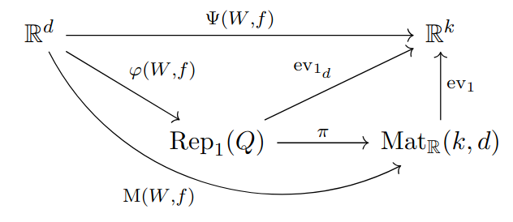

# Knowledge Matrix



Given a neural network (W,f) [1] with network function Ψ(W,f) and an input x ∈ ℝᵈ, compute the knowledge matrix M(W,f)(x). 
They were introduced in [2] and studied further in [3]. 

#### References 

[1] Armenta, M., Jodoin, P-M., <a href="https://arxiv.org/abs/2007.12213" target="_blank">The Representation Theory of Neural Networks</a> (2021)

[2] Armenta, M., Brüstle, T., Hassoun, S., Reineke, M., <a href="https://arxiv.org/abs/2109.14589" target="_blank">Double framed moduli spaces of quiver representations</a> (2021)

[3] Leblanc, S., Rasolomanana, A., Armenta, M., <a href="https://arxiv.org/abs/2409.13163" target="_blank">Hidden Activations Are Not Enough: A General Approach to Neural Network Predictions</a> (2024)

## Download & Use

You can download this using

```
pip install git+https://github.com/samueleblanc/knowledgematrix.git
```

For an example on how to use, please refer to [example.py](example.py).

## Large language models

The library rebuilds a pretrained decoder as an `NN` computing the same
function as the Hugging Face model, so its knowledge matrices can be
computed. Loading needs the optional dependencies
(`pip install "knowledgematrix[hf]"`: transformers, safetensors,
huggingface_hub).

```python
from transformers import AutoTokenizer
from knowledgematrix.models.hub import load_llm
from knowledgematrix.row_computer import KnowledgeRowComputer

name = "HuggingFaceTB/SmolLM2-135M"          # or just "SmolLM2-135M"
model = load_llm(name)
tokenizer = AutoTokenizer.from_pretrained(name)

x = tokenizer("The capital of France is", return_tensors="pt").input_ids.unsqueeze(0)  # (1, 1, T)
logits = model.forward(x)                    # (1, 1, T, vocab)

# the knowledge-matrix rows of the three most likely next tokens
T, V = logits.shape[-2], logits.shape[-1]
rows = [(T - 1) * V + v for v in logits[0, 0, -1].topk(3).indices.tolist()]
M = KnowledgeRowComputer(model).forward(x, rows)   # (3, T * hidden + 1); each row sums to its logit
```

`load_llm` takes the name of a supported checkpoint, any hub repository or
local directory holding a checkpoint of a supported architecture (an
instruct variant, a fine-tune, an ungated mirror), or a transformers model
already in memory. It picks the network class from the checkpoint's config:

| Family | `config.model_type` | Class | Checkpoints the tests are built on |
|---|---|---|---|
| Llama | `llama`, `mistral`, `ministral`, `qwen2`, `qwen3` | `LlamaLike` | Llama-3.1-8B, Llama-3.2-1B / 3B, Llama-3.3-70B-Instruct, SmolLM2-135M / 360M / 1.7B, Qwen3-8B / 14B |
| Gemma | `gemma2`, `gemma3`, `gemma3_text` | `GemmaLike` | Gemma-2 2b / 9b / 27b, Gemma-3 270m / 1b / 4b / 12b / 27b |
| Qwen3.5 | `qwen3_5`, `qwen3_5_text` | `Qwen3_5` | Qwen3.5-0.8B / 2B / 4B / 9B / 27B |

`knowledgematrix.models.hub.SUPPORTED_LLMS` lists them with their
repositories. An architecture or a config option the library does not
reproduce (a mixture-of-experts variant, bidirectional attention, an
unsupported RoPE type, ...) is refused with an error rather than loaded as
something else. The multimodal checkpoints (Gemma-3 4b and larger, Qwen3.5)
are supported as text models: the vision tower is ignored. GPT-2 and
GPT-NeoX / Pythia have their own adapters (`models/gpt2.py`,
`models/gpt_neox.py`).

### Which matrix

With the LM head the matrix has `T * vocab` rows and `T * hidden + 1`
columns, far too large to build in full for a real model. Two things make
it tractable:

* **Rows instead of columns** — `KnowledgeRowComputer(model).forward(x, rows)`
  computes selected rows by reverse mode, one backward pass per row
  whatever the input size. This is the efficient direction when a few
  outputs (the logits of some answer tokens) are studied over all inputs.
  `KnowledgeMatrixComputer(model).forward(x)` builds every column and is
  for short prompts and small models. By default the last entry of a row
  (the bias) is the remainder, output minus the rest;
  `forward(x, rows, independent_bias=True)` computes it by its own pass
  through the linearized network instead, which turns "the row sums to
  the output" into a check of the row.
* **Stopping before the head** — `load_llm(name, include_lm_head=False)`
  ends the network at the final norm (`T * hidden` rows). The head is a
  linear map, so the rows of any logit follow from these.

How the token-mixing layers are linearized is a choice (`mixer_mode`):

* `"ratio"` — attention, the gated MLPs and the linear-attention recurrence
  are treated like activations, by the elementwise post/pre ratio.
  Attribution stays within each token position (the matrix is block
  diagonal over positions). Default of `KnowledgeMatrixComputer`.
* `"frozen"` — each such layer is applied as a linear map with its routing
  (attention weights, recurrence gates, MLP gates) frozen at the actual
  input, so attribution flows across positions through the value paths.
  Default of `KnowledgeRowComputer`, and the mode to use for cross-token
  attribution.

Both reproduce the forward pass exactly: every row sums to its output.
Gemma-2 soft-caps its final logits; the cap is a layer of the network
(`SoftCap`), so the rows sum to the capped logits the model actually
outputs (`load_llm(..., final_softcap=False)` gives the uncapped ones).

### Large models

A checkpoint is read from its safetensors files one tensor at a time,
without instantiating the transformers model, and each tensor goes straight
to the device of the layer that owns it. Host memory stays at one tensor.

```python
import torch
from knowledgematrix.models.hub import load_llm, llm_footprint

# what will it take? (from the config alone: nothing is downloaded or allocated)
llm_footprint("meta-llama/Llama-3.3-70B-Instruct", dtype=torch.bfloat16,
              devices=["cuda:0", "cuda:1", "cuda:2"], include_lm_head=False)
# {'parameters': 69503033344, 'gib': 129.5, 'per_device': [{'device': 'cuda:0', 'gib': 43.4, ...}, ...]}

model = load_llm("meta-llama/Llama-3.3-70B-Instruct", dtype=torch.bfloat16,
                 device=["cuda:0", "cuda:1", "cuda:2"], include_lm_head=False)
```

* `dtype` defaults to float32. bfloat16 halves the memory, at the price of
  the row-sum identity holding to about 1e-2 instead of 1e-6: it is a
  storage format, to be used when the model does not fit otherwise.
* `device` may be a list: the network is then a pipeline over the devices,
  cut at block boundaries that balance the parameter count (`boundaries=`
  to choose them; see `NN.shard`). Both computers follow the pipeline.
* The gated repositories (Llama, Gemma) need a hub token with access
  (`huggingface-cli login`, or `token=`).

Weights of the network without its LM head, i.e. the minimum to hold
(activations come on top and grow with the sequence length):

| Checkpoint | Parameters | bfloat16 (GiB) | float32 (GiB) |
|---|---|---|---|
| SmolLM2-135M / 360M / 1.7B | 0.13 B / 0.36 B / 1.71 B | 0.3 / 0.7 / 3.2 | 0.5 / 1.3 / 6.4 |
| Llama-3.2-1B / 3B | 1.24 B / 3.21 B | 2.3 / 6.0 | 4.6 / 12.0 |
| Llama-3.1-8B | 7.50 B | 14.0 | 28.0 |
| Llama-3.3-70B-Instruct | 69.50 B | 129.5 | 258.9 |
| Qwen3-8B / 14B | 7.57 B / 13.99 B | 14.1 / 26.1 | 28.2 / 52.1 |
| Qwen3.5-4B / 27B | 4.21 B / 25.62 B | 7.8 / 47.7 | 15.7 / 95.5 |
| Gemma-2 2b / 9b / 27b | 2.61 B / 9.24 B / 27.23 B | 4.9 / 17.2 / 50.7 | 9.7 / 34.4 / 101.4 |
| Gemma-3 270m / 1b / 4b / 12b / 27b | 0.27 B / 1.00 B / 3.88 B / 11.77 B / 27.01 B | 0.5 / 1.9 / 7.2 / 21.9 / 50.3 | 1.0 / 3.7 / 14.5 / 43.8 / 100.6 |

### Checking a checkpoint

```
python -m knowledgematrix.models.verify meta-llama/Llama-3.2-3B --tokens 256
python -m knowledgematrix.models.verify meta-llama/Llama-3.3-70B-Instruct \
    --dtype bfloat16 --device cuda:0,cuda:1,cuda:2 --reference-device-map auto --tokens 256
```

computes the logits with transformers, frees that model, loads the
knowledge-matrix network and reports the gap between the two relative to
the logit scale, the agreement on the top token, and whether
knowledge-matrix rows (with an independently computed bias) sum to their
logits. The two models are never in memory together.

What the test suite establishes, and what it cannot: for every checkpoint
above, the real transformers class is instantiated on the published config
with only its sizes scaled down, and the network must reproduce it — with
negative controls showing that each mechanism (RoPE base and rescaling,
q/k normalization, sliding windows, soft-caps, head grouping, ...) is
actually tested — and the full-size architecture is checked tensor by
tensor without weights. Real weights can only be compared where the
checkpoint is at hand. Measured with `verify` in float32 on a CPU:

| Checkpoint | Tokens | Logit gap / logit scale | Same top token | Row-sum gap / row mass |
|---|---|---|---|---|
| SmolLM2-135M | 600 | 3.2e-6 | 100 % | 3.6e-7 |
| Llama-3.2-1B | 600 | 2.1e-6 | 100 % | 1.8e-7 |
| Llama-3.2-3B-Instruct | 256 | 4.6e-6 | 100 % | 2.8e-7 |
| Qwen3-0.6B | 600 | 1.5e-5 | 100 % | 3.5e-7 |
| Gemma-3-270m | 600 | 3.3e-6 | 100 % | 1.2e-7 |
| Qwen3.5-0.8B | 300 | 1.6e-6 | 100 % | 1.4e-7 |
| Qwen3.5-4B | 200 | 1.2e-5 | 100 % | 4.5e-7 |

(The Llama and Gemma weights were read from the ungated `unsloth/`
mirrors of the gated repositories. For scale: transformers' own two
attention implementations differ from each other by about 7e-6 on these
models.) The other checkpoints —
Llama-3.1-8B, Llama-3.3-70B, Qwen3-8B / 14B, Qwen3.5-27B, Gemma-2 and the
larger Gemma-3 — share their code path with the ones above but have not
been run with their own weights: `verify` is the check to run on the
machine that holds them.

## Contributing

Any contribution is welcomed. Thank you in advance! 
However, we are primarily interested with help on the following:

* Implement other type of layers or other architecture.
* Improve memory efficiency or speed.

To set up, once the code is downloaded, simply run 
```
pip install -e .
```
in the root directory. 
Then, to run a file, for instance the test for AlexNet, run
```
python extra/tests/alexnet.py
```
again from the root directory.

## Authors

This code was written by Marco Armenta and Samuel Leblanc.

## License

MIT